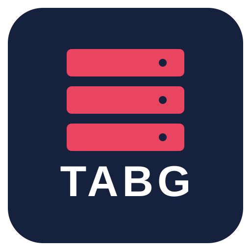

<div align="center">


# tabg

**Host a Totally Accurate Battlegrounds server for your friends.**

</div>

> **Status: rebuilding from scratch.** This repo is being rewritten as a single Rust program
> with its own TABG game server. Nothing is usable yet. The previous C# installer (v5.2.0 and
> earlier) is retired.

## The plan

- **`tabg`**: one small program for Windows and Linux. Double-click it, a dashboard opens in
  your browser, and a few minutes later you have a server and a join code for your friends.
- **Our own game server in Rust**: unmodified TABG clients can join; no Unity server, SteamCMD
  or BepInEx needed on the host.
- **Optional client mods** (proximity chat, vehicles, maps…): friends run `tabg join <code>` once
  and get exactly the mods the server uses.

The full design, decisions and milestones are in [docs/DESIGN.md](docs/DESIGN.md).

## Repo layout

```
crates/   Rust workspace: the tabg binary and (soon) the game server
mods/     C# BepInEx client mods (optional extras), built locally against your own TABG install
docs/     design documents
```

## Building

```bash
cargo build                 # the tabg tool

# client mods: point at a modded TABG client copy that has BepInEx installed
export TABG_CLIENT_DIR=~/.local/share/Steam/steamapps/common/TotallyAccurateBattlegrounds-Modded
dotnet build mods/Mods.sln -c Release
dotnet test mods/tests/ClientMods.Tests
dotnet run --project mods/tests/Vehicles.Tests
```

Game, Unity and BepInEx assemblies are never committed. The mods compile against your own install.

## Legal

tabg is an unofficial fan project, not affiliated with Landfall Games. It contains no Landfall code
or assets; map data is extracted from your own copy of the game on your machine. MIT licensed.

Third-party code: `crates/tabg-enet-sys/vendor` contains ENet-CSharp 2.4.8 (MIT, © Stanislav Denisov and
the ENet authors).
